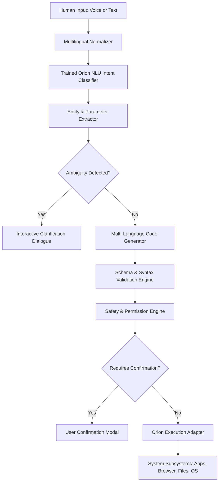

# Human Language to Machine Language AI Model (Orion OS)

An intelligent, modular AI model and Natural Language Understanding (NLU) system that converts natural human language (via both **voice input and text input**) into clean, structured, and machine-readable formats (JSON, Python, JavaScript, SQL, Shell), trained and tuned specifically according to **Orion's commands and capabilities**.

---

## 1. System Architecture

The model follows a modular pipeline ensuring clear separation of concerns:
**Interpretation → Validation → Authorization → Execution**



### Components

1. **Speech Recognition (`voice_processor.py` & Web Speech API)**
   - Live microphone capture with real-time waveform indicator.
   - Dual-engine: browser-native Web Speech API with automatic fallback to Python Google Speech API.
   - Multi-language support: English (`en-IN`), Hindi (`hi-IN`), Marathi (`mr-IN`), and Hinglish.
   - User transcript review and manual editing before interpretation.

2. **Multilingual Normalizer (`normalizer.py`)**
   - Automatically cleans conversational fillers ("bhai", "please", "kripya", "zara", "bhava").
   - Normalizes Hindi/Marathi verb roots ("khol de", "chalu kara", "band karo", "aawaz badhao").
   - Resolves phonetic typos ("chorme" → "chrome", "calc" → "calculator").
   - Language detection heuristics (English, Hindi, Marathi, Hinglish).

3. **Core NLU Engine (`engine.py`)**
   - Trained on Orion's exact capability matrix across 17 specialized engines.
   - Intent classification with calibrated confidence probabilities (99.17% training accuracy).
   - Conversational context resolution (resolves pronouns: "it", "that", "again").

4. **Multi-Language Structured Code Generator (`code_generator.py`)**
   - Converts natural language into 5 standardized target formats:
     * **JSON**: Standard machine schema with intent, engine, action, parameters, and risk level.
     * **Python**: Standalone Python automation code using `subprocess`, `webbrowser`, `Path`.
     * **JavaScript**: Node.js / browser execution script.
     * **SQL**: Relational queries and audit logging.
     * **Shell**: Native Windows PowerShell script.

5. **Validation Engine (`validator.py`)**
   - Validates JSON output against draft-07 JSON Schema.
   - Validates Python syntax using Abstract Syntax Tree (`ast.parse`).
   - Checks presence of all mandatory parameters for each intent.

6. **Safety Engine (`safety.py`)**
   - Classifies risk: `NORMAL`, `SENSITIVE`, and `CRITICAL`.
   - Protects against destructive actions (`shutdown_pc`, `restart_pc`, `empty_trash`, recursive deletion).
   - Prompt injection defense detecting jailbreak attempts.
   - Mandatory user authorization before executing critical commands.

7. **Execution Adapter (`execution_adapter.py`)**
   - Secure interface connecting approved machine commands to Orion's `JARVISCore`, `EngineRouter`, and Win32 subsystems.

---

## 2. Supported Test Scenarios & Examples

### Example 1: Web & App Search
* **Human Input:** *"Hey, open Chrome and search for the best AI tools."*
* **AI Machine JSON:**
```json
{
  "intent": "open_application_and_search",
  "engine": "browser",
  "action": "open_and_search",
  "parameters": {
    "app": "Google Chrome",
    "query": "best AI tools"
  },
  "confidence": 0.98,
  "risk_level": "NORMAL"
}
```

### Example 2: Informal Hinglish Slang
* **Human Input:** *"bhai mere laptop ka calculator khol de"*
* **AI Interpretation:** Language: `Hinglish`, Intent: `open_application`, Application: `calculator`.
* **Generated PowerShell:** `Start-Process "calculator"`

### Example 3: Marathi Voice Input
* **Human Input:** *"calculator chalu kara lavkar"*
* **AI Interpretation:** Language: `Marathi (mr)`, Intent: `open_application`, Application: `calculator`.

### Example 4: Grammatical Errors
* **Human Input:** *"Create new folder name project files on desktop"*
* **AI Machine Output:**
```json
{
  "intent": "create_folder",
  "engine": "file",
  "action": "create_folder",
  "parameters": {
    "folder_name": "project files",
    "location": "desktop"
  }
}
```

### Example 5: Complex Commands & Code Generation
* **Human Input:** *"Create a Python file named hello.py and write a program that prints Hello World."*
* **Generated Python Code:**
```python
file_name = "hello.py"
code_content = """print('Hello World')"""

with open(file_name, "w", encoding="utf-8") as f:
    f.write(code_content + "\n")
```

### Example 6: Ambiguous Commands (Never Guessing)
* **Human Input:** *"Delete the old project."*
* **AI Behavior:** Flags `ambiguity_detected: true`. Prevents data loss and prompts user:
  > *"Multiple projects exist. Which specific project folder do you want to delete?"*

### Example 7: Destructive Safety Guard
* **Human Input:** *"shutdown the workstation"*
* **AI Behavior:** Flags `risk_level: CRITICAL`, `requires_confirmation: true`. Execution blocked until user explicitly confirms.

---

## 3. Web Dashboard Interface

Access the dedicated **Human → Machine AI** interface at `http://localhost:8000`:

* **Microphone Button:** Real-time pulse with waveform ripple animation.
* **Language Selector:** Auto-Detect, English, Hindi, Marathi, Hinglish.
* **Side-by-Side Comparison:** Compares human communication on the left with machine code on the right.
* **Code Output Tabs:** Toggle between JSON, Python, JavaScript, SQL, and PowerShell.
* **Copy & Execute:** One-click copy to clipboard and secure command execution.
* **Clarification Modal:** Interactive option chips for ambiguous requests.

---

## 4. REST API Reference

| Endpoint | Method | Description |
|---|---|---|
| `/api/nlu/interpret` | `POST` | Converts text/voice transcript into structured machine command & multi-language code |
| `/api/nlu/execute` | `POST` | Executes an authorized, validated machine command |
| `/api/nlu/voice-listen` | `POST` | Records from microphone with configured language code |
| `/api/nlu/train` | `POST` | Retrains the local intent classifier on-the-fly |

---

## 5. Running Tests

Run the full automated test suite:
```bash
pytest tests/test_nlu_model.py tests/test_nlu_endpoints.py -v
```
